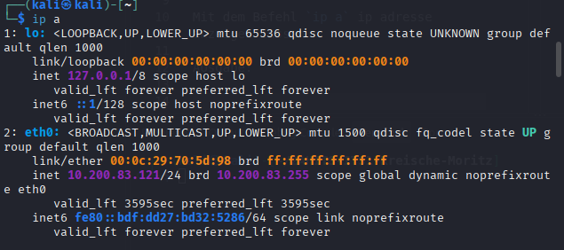
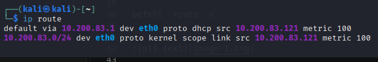
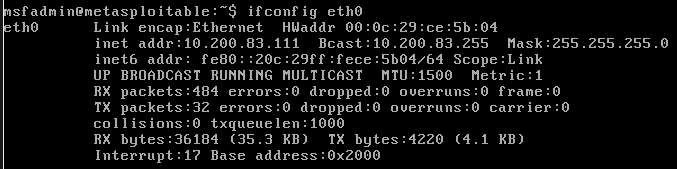
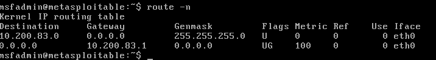

 -Klasse: 3AHITS
 -Name: Moritz Kreische
 -Fach ITSE
 -Gruppe: 1
 -Datum der Übung: 10.11.2026
 -Titel:Ü2 Networking Kali + Metasploitable

Übung2.1 

Mit dem Befehl `ip a` ip adresse anzeigen lassen 

Ausgabe:

Befehl: `ip route`

Ausgabe:

metaspoitable:

Befehl:`ifconfig eth0`

befehl `route -n`

ping kali->Meta

ping meta->kali

# Nicht gemacht:

Übung 2.2(Dateiserver per Webserver Metaspoitable -> Kali)
Übung 2.3(Dateiserver per Webserver Kali->Metaspoitable)

